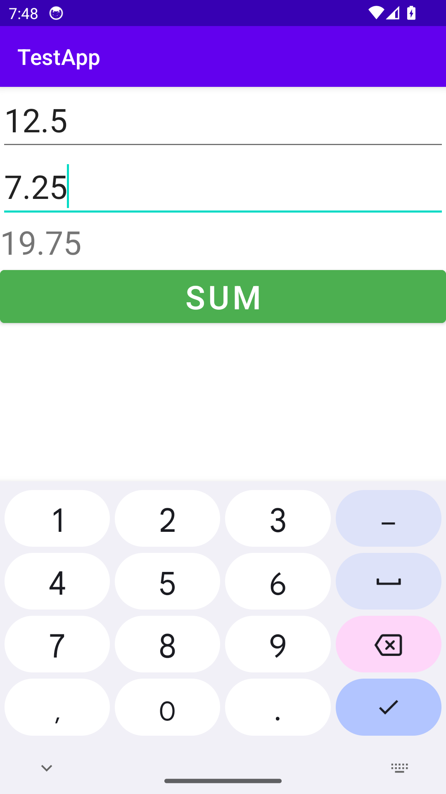

# AddToNumK — Сложение двух чисел

Доработка Android-приложения для сложения чисел ([ipetrushin/AddToNumK](https://github.com/ipetrushin/AddToNumK)).

---

## 📌 Выполненные задачи

1. **TODO 1: Реализовать проверку на пустые значения в полях `numA`, `numB`**
   - Добавлена проверка на пустоту строк `trim().isEmpty()`.
   - Если одно или оба поля пустые, отображается ошибка `error = "Введите число"`, выводится `Toast` с предупреждением и выполнение прерывается без падения приложения.
   - Также выполняется безопасная проверка на корректность чисел через `toDoubleOrNull()`.

2. **TODO 2: Исправить разметку, чтобы можно было вводить только числа**
   - В `activity_main.xml` для полей `numA` и `numB` установлен атрибут:
     ```xml
     android:inputType="numberDecimal|numberSigned"
     ```
   - Клавиатура открывается только с цифрами, точкой/запятой и знаком минус (ввод букв недоступен).
   - Исходный дизайн и структура разметки полностью сохранены.

3. **TODO 3: Сделать поддержку вещественных (не целых) чисел**
   - Исходный метод `toInt()` заменён на `toDoubleOrNull()`.
   - Сумма вычисляется в вещественном формате (`Double`).
   - Если результат целый (например, `2.5 + 2.5 = 5.0`), отображается без `.0`, иначе выводится дробное число (например, `12.5 + 7.25 = 19.75`).

4. **Кнопка зелёного цвета**
   - Кнопке **SUM** задан атрибут:
     ```xml
     android:backgroundTint="#4CAF50"
     ```

---

## 💻 Исходный код

### 1. Разметка: `app/src/main/res/layout/activity_main.xml`

```xml
<?xml version="1.0" encoding="utf-8"?>
<LinearLayout xmlns:android="http://schemas.android.com/apk/res/android"
    xmlns:app="http://schemas.android.com/apk/res-auto"
    xmlns:tools="http://schemas.android.com/tools"
    android:layout_width="match_parent"
    android:layout_height="match_parent"
    android:orientation="vertical"
    tools:context=".MainActivity">

    <EditText
        android:textSize="30sp"
        android:layout_width="match_parent"
        android:layout_height="wrap_content"
        android:inputType="numberDecimal|numberSigned"
        android:id="@+id/numA"/>
    <EditText
        android:textSize="30sp"
        android:layout_width="match_parent"
        android:layout_height="wrap_content"
        android:inputType="numberDecimal|numberSigned"
        android:id="@+id/numB" />
 <TextView
     android:textSize="30sp"
     android:layout_width="match_parent"
     android:layout_height="wrap_content"
     android:id="@+id/sum" />

    <Button
        android:text="Sum"
        android:textSize="30sp"
        android:layout_width="match_parent"
        android:layout_height="wrap_content"
        android:backgroundTint="#4CAF50"
        android:onClick="onClick"
        />


</LinearLayout>
```

### 2. Логика: `app/src/main/java/com/example/testapp/MainActivity.kt`

```kotlin
package com.example.testapp

import androidx.appcompat.app.AppCompatActivity
import android.os.Bundle
import android.view.View
import android.widget.EditText
import android.widget.TextView
import android.widget.Toast

class MainActivity : AppCompatActivity() {
    override fun onCreate(savedInstanceState: Bundle?) {
        super.onCreate(savedInstanceState)
        setContentView(R.layout.activity_main)
    }
    // TODO: 1) реализовать проверку на пустые значения в полях numA, numB
    // TODO: 2) исправить разметку, чтобы можно было вводить только числа
    // TODO: 3) сделать поддержку вещественных (не целых чисел)

    fun onClick(v: View) {
        val etA = findViewById<EditText>(R.id.numA)
        val etB = findViewById<EditText>(R.id.numB)
        val tvSum = findViewById<TextView>(R.id.sum)

        val strA = etA.text.toString().trim()
        val strB = etB.text.toString().trim()

        if (strA.isEmpty() || strB.isEmpty()) {
            if (strA.isEmpty()) etA.error = "Введите число"
            if (strB.isEmpty()) etB.error = "Введите число"
            Toast.makeText(this, "Заполните оба поля!", Toast.LENGTH_SHORT).show()
            return
        }

        val numA = strA.toDoubleOrNull()
        val numB = strB.toDoubleOrNull()

        if (numA == null || numB == null) {
            Toast.makeText(this, "Введите корректные числа!", Toast.LENGTH_SHORT).show()
            return
        }

        val sum = numA + numB
        val strSum = if (sum % 1.0 == 0.0) sum.toLong().toString() else sum.toString()
        tvSum.text = strSum
    }
}
```

---

## 📱 Демонстрация работы

### 1. Дефолтный экран
Исходное состояние экрана приложения (исходный лейаут, зелёная кнопка **SUM**):


### 2. Пример работы со сложением вещественных чисел
Ввод вещественных чисел `12.5` и `7.25` через цифровую клавиатуру, результат суммы — `19.75`:


