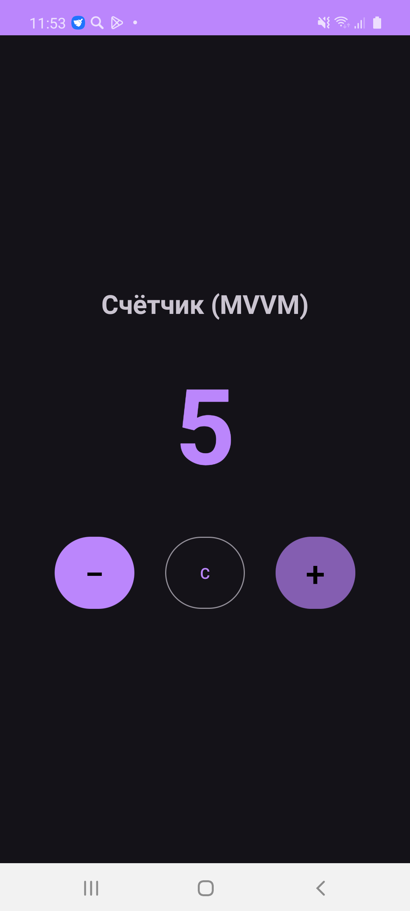

# MVVM Counter (Счётчик на MVVM паттерне)

Простое Android-приложение «Счётчик», реализованное с использованием архитектурного паттерна **MVVM (Model-View-ViewModel)** и компонентов Android Jetpack (`ViewModel`, `LiveData`, `ViewBinding`).

## Скриншот работы приложения



## Архитектура приложения

Приложение чётко разделено на три слоя в соответствии с шаблоном MVVM:

```
                  ┌────────────────────────┐
                  │          View          │
                  │     (MainActivity)     │
                  └───────────┬────────────┘
                              │  ▲
             вызовы методов   │  │ подписка на LiveData
             (User Actions)   │  │ (Data Observation)
                              ▼  │
                  ┌────────────────────────┐
                  │       ViewModel        │
                  │   (CounterViewModel)   │
                  └───────────┬────────────┘
                              │  ▲
             бизнес-логика    │  │ возвращаемые данные
                              ▼  │
                  ┌────────────────────────┐
                  │         Model          │
                  │     (CounterModel)     │
                  └────────────────────────┘
```

### 1. Model (`model/CounterModel.kt`)
* Инкапсулирует состояние счётчика (`count`) и правила его изменения.
* Предоставляет методы `increment()`, `decrement()` и `reset()`.
* Полностью изолирована от Android фреймворка, что облегчает её независимое модульное тестирование.

### 2. ViewModel (`viewmodel/CounterViewModel.kt`)
* Наследуется от `androidx.lifecycle.ViewModel`.
* Хранит состояние с использованием `MutableLiveData` (приватное) и публичного неизменяемого `LiveData`.
* Сохраняет состояние при перевороте экрана (configuration change).
* Делегирует операции изменения данных слою Model и уведомляет View через обновление LiveData.

### 3. View (`view/MainActivity.kt`)
* Наследуется от `AppCompatActivity`.
* Использует `ViewBinding` для безопасного доступа к элементам интерфейса.
* Подписывается на `counter: LiveData<Int>` из `CounterViewModel`.
* Перенаправляет действия пользователя (нажатия на кнопки) в соответствующие методы ViewModel.

## Возможности
* Увеличение счётчика (`+`).
* Уменьшение счётчика (`−`).
* Сброс значения к 0 (`C`).
* Сохранение состояния при смене конфигурации (поворот экрана).
* Модульные unit-тесты (`CounterModelTest`).
