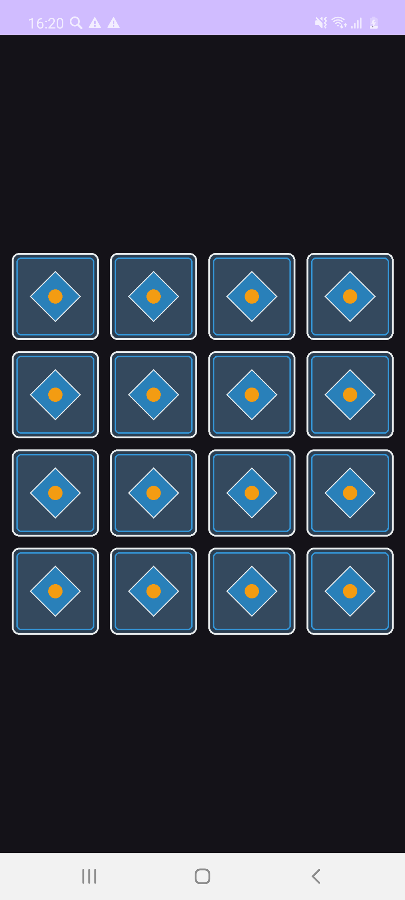
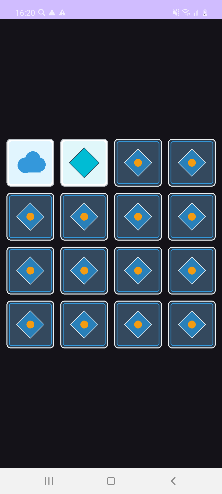
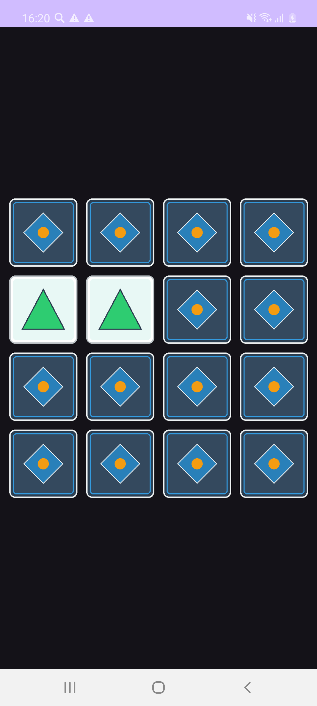
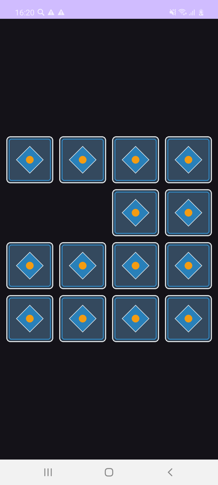
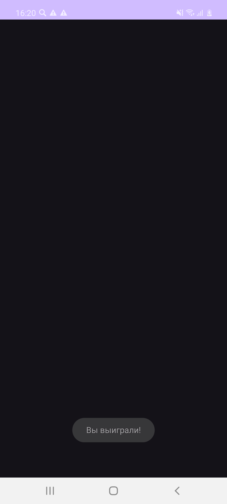

# MemorinaK

## Демонстрация работы

| Начальное поле | Открытие разных карт | Возврат рубашек |
| :---: | :---: | :---: |
|  |  |  |

| Совпавшая пара | Исчезновение пары | Победа (все карты исчезли) |
| :---: | :---: | :---: |
|  |  |  |

## Что сделано

1. **Колода карт**: в проект добавлены 8 пар картинок и рубашка.
2. **Перемешивание**: перед началом игры колода формируется парами и перемешивается (`deck.shuffle()`).
3. **Игровое поле**: 16 карт (сетка 4x4) отображаются рубашками вверх.
4. **Игровая логика**:
   * При клике на карту открывается её лицевая сторона.
   * Если открыты две одинаковые карты, они исчезают с поля (`visibility = View.INVISIBLE`).
   * Если открыты разные карты, они через паузу в 1 секунду переворачиваются обратно рубашкой вверх.
5. **Проверка на выигрыш**: когда все карты исчезают, выводится Toast «Вы выиграли!».

## Структура проекта

* `MainActivity.kt`: разметка сетки 4x4, логика перемешивания карт, обработка кликов (`colorListener`), проверка пары (`openCards`) и проверка выигрыша (`checkWin`).
* `res/drawable/`: картинка рубашки (`card_back.png`) и лицевые стороны картинок.
* `MemorinaUnitTest.kt`: тесты формирования колоды, перемешивания, проверки совпадения и условия победы.
