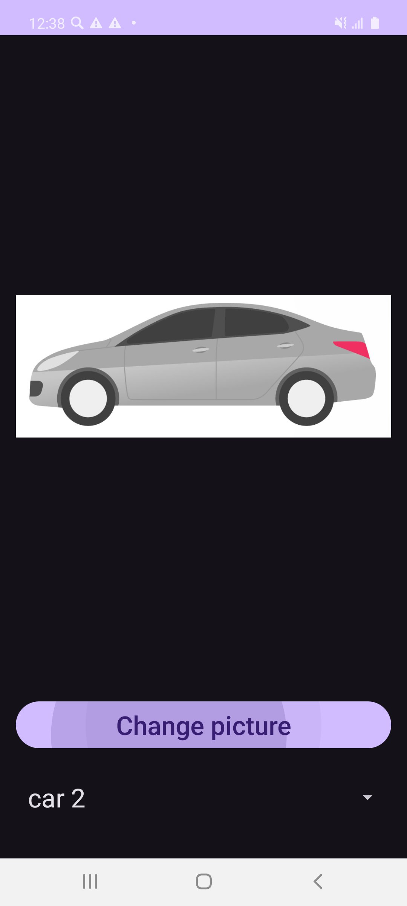
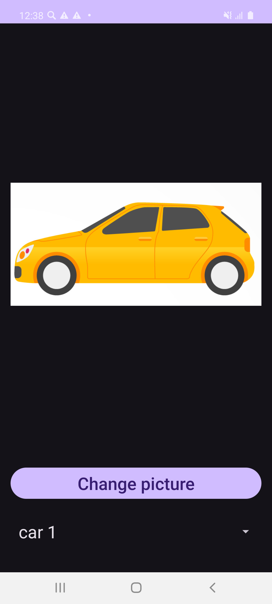
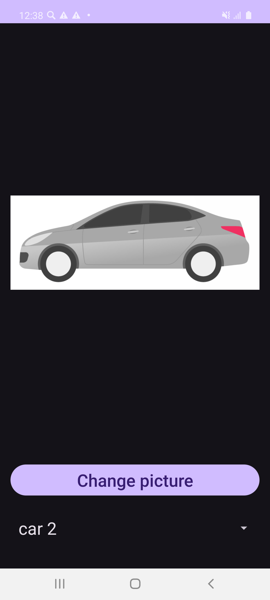
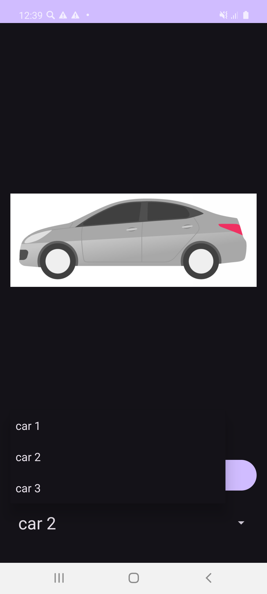
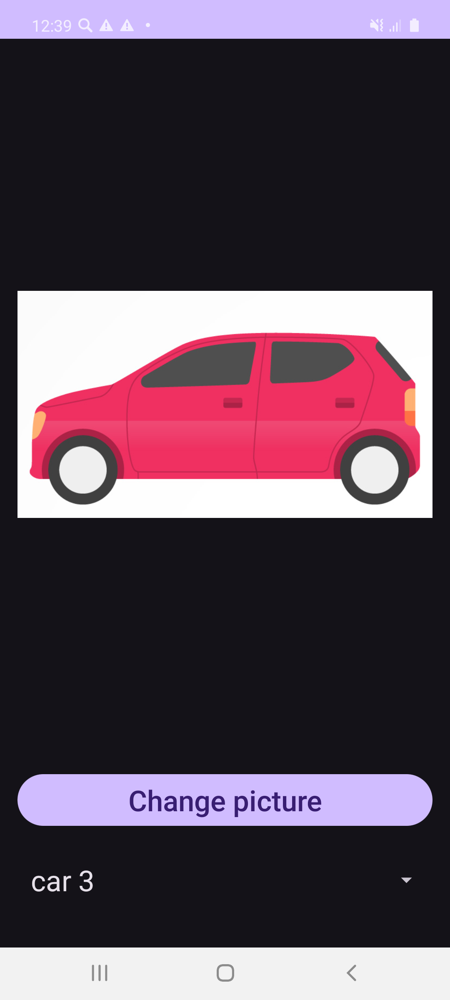
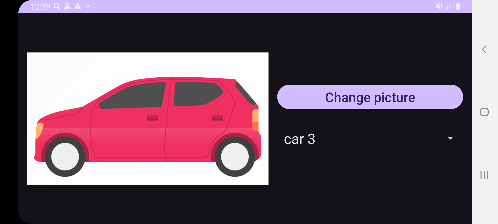
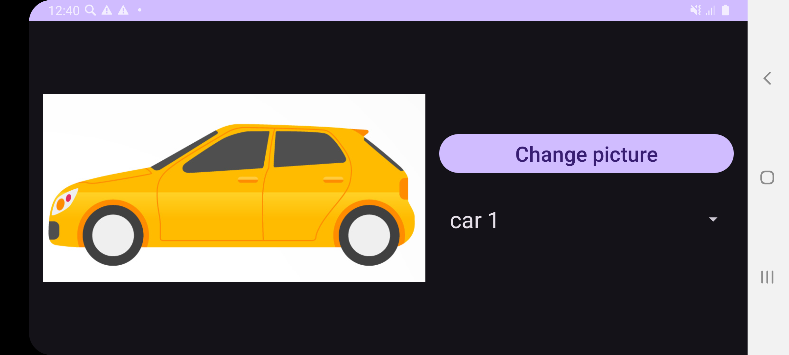

# 📱 PortraitLandscapePresentK2023

Android-приложение на Kotlin, демонстрирующее адаптацию интерфейса под портретную и альбомную ориентации экрана, работу с выпадающим списком (`Spinner`), циклическое переключение картинок и сохранение состояния через `SharedPreferences`.

---

## ✨ Реализованный функционал

* 🔄 **Адаптивная разметка:**
  * 📱 **Портретная ориентация:** вертикальное расположение элементов (изображение сверху, кнопка и `Spinner` снизу).
  * 🖥️ **Альбомная ориентация:** горизонтальное разделение экрана (изображение слева, панель управления справа).
* 🚗 **Смена изображений:**
  * Нажатие кнопки «Change picture» циклически переключает машины: `car1` ➔ `car2` ➔ `car3` ➔ `car1`...
  * При первом запуске отображается исходный котик (`squarecat`).
* 📑 **Выпадающий список (Spinner):**
  * Выбор изображения напрямую из выпадающего списка с синхронизацией текущего состояния.
* 💾 **Сохранение состояния (SharedPreferences):**
  * Выбранная картинка сохраняется в памяти устройства и восстанавливается при повороте экрана и после перезапуска приложения.

---

## 📸 Скриншоты работы приложения

### 1. 🐱 Начальный запуск (исходный котик в портретной ориентации)

### 2. 🚗 Переключение на car 1 по кнопке

### 3. 🚙 Переключение на car 2 по кнопке

### 4. 📂 Открытие выпадающего списка Spinner

### 5. 🏎️ Выбор car 3 через Spinner

### 6. 🔄 Поворот экрана в альбомную ориентацию (сохранение car 3)

### 7. 🚘 Переключение на car 1 в альбомной ориентации

### 8. 📱 Возврат в портретную ориентацию (состояние сохранено)

### 9. 💾 Холодный перезапуск (загрузка из SharedPreferences)

