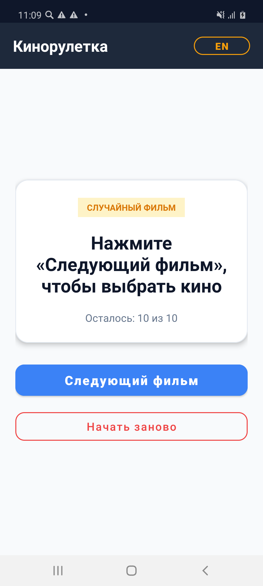
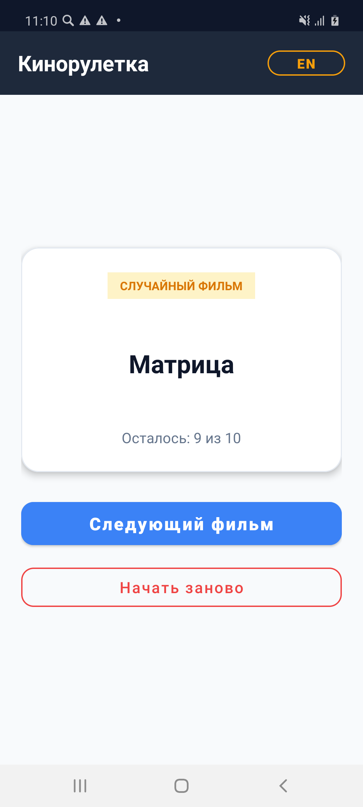
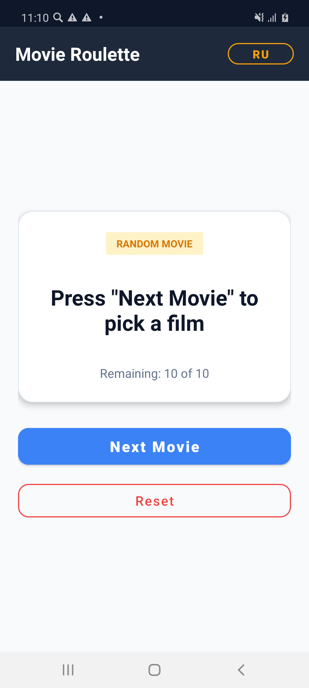
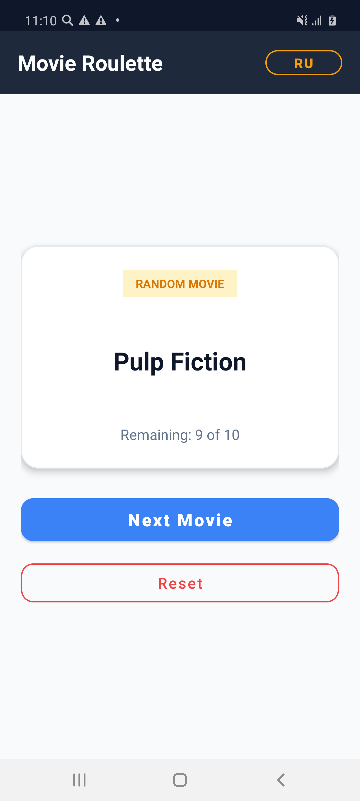
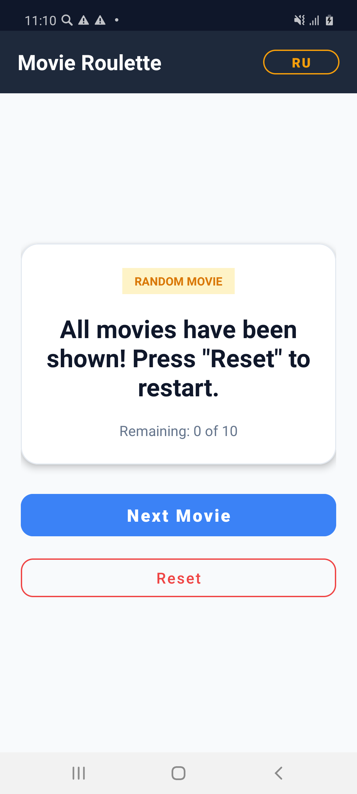

# RandomFilmK

Приложение «Случайный фильм» на Kotlin для Android с хранением фильмов в строковых ресурсах `strings.xml`, поддержкой двух локализаций (русский и английский), показом фильмов без повторений и кнопкой сброса.

## Скриншоты работы приложения

### 1. Русская локализация (начальный экран)

### 2. Русская локализация (выбран фильм)

### 3. Английская локализация (начальный экран)

### 4. Английская локализация (выбран фильм)

### 5. Все фильмы просмотрены

