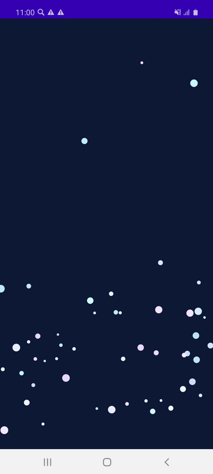
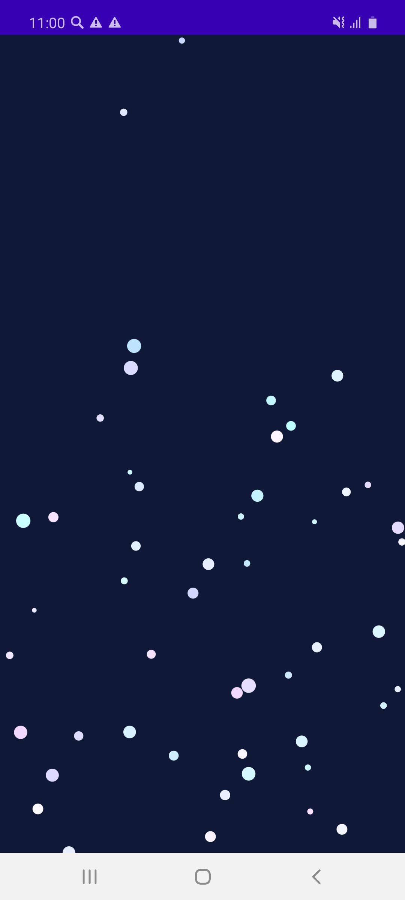

# Snowflakes

Падающие снежинки на Canvas с использованием фонового потока AsyncTask.

## Что сделано
* **Свой View:** класс `Snowflakes` используется вместо обычной разметки (`setContentView`).
* **Разные оттенки:** цвет каждой снежинки задается через `Color.rgb()`.
* **Замедление:** вверху экрана снежинки падают быстро, а к низу экрана замедляются.
* **Качание в стороны:** снежинки плавно покачиваются влево и вправо с помощью синуса `sin()`.
* **Фоновый поток (AsyncTask):** задержка кадров считается в фоне, а само движение и перерисовка передаются на экран.
* **Управление по тапу:** нажатие на экран ставит анимацию на паузу и возобновляет её.

## Демонстрация работы

### Анимация снегопада

### Скриншот приложения

