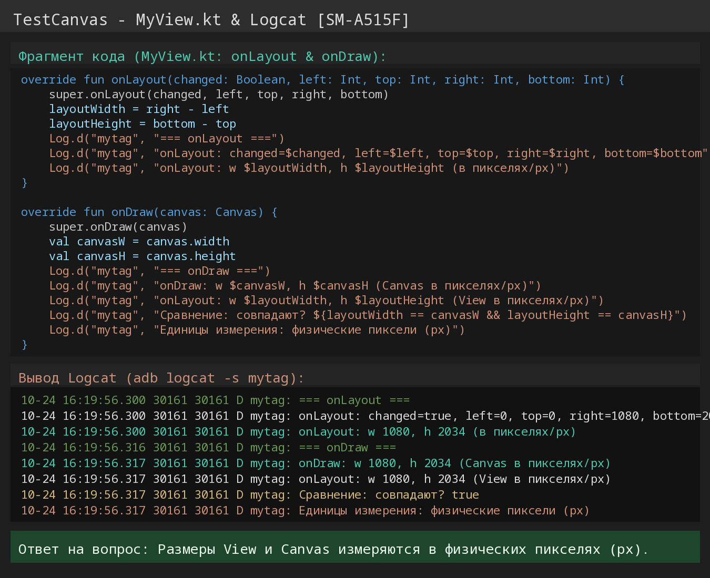
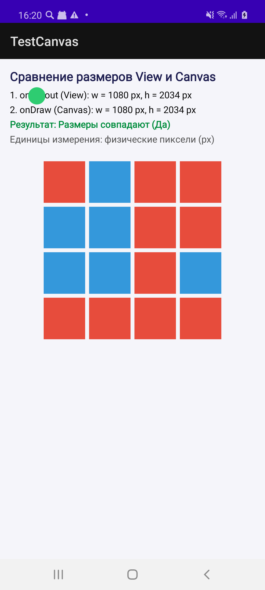

# TestCanvas: Сравнение ширины и высоты View

Android-приложение на Kotlin, демонстрирующее измерение размеров кастомного элемента пользовательского интерфейса (`View`) во время его создания в методе `onLayout()` и сопоставление этих значений с размерами холста (`Canvas.width`, `Canvas.height`) в методе `onDraw()`.

---

## Ответы на вопросы задания

### 1. В каких единицах измеряются полученные значения?
* **Полученные значения измеряются в физических пикселях (px / pixels).**
* Методы `View.getWidth()`, `View.getHeight()`, а также параметры `left, top, right, bottom` в `onLayout()` и свойства `canvas.width`, `canvas.height` в `onDraw()` возвращают размеры именно в экранных пикселях устройства (`px`), а не в аппаратно-независимых единицах (`dp`/`dip`).

### 2. Сравнение размеров:
* **Размеры View из `onLayout` (`layoutWidth = right - left`, `layoutHeight = bottom - top`) и размеры холста Canvas в `onDraw` (`canvas.width`, `canvas.height`) полностью совпадают.**
* В полноэкранном режиме кастомного `MyView` они равны доступной области контента Activity (на тестовом устройстве Samsung Galaxy A51: **1080 x 2034 px**).

---

## Логирование в Logcat

При запуске приложения в Logcat выводятся строки с тегом `mytag`:

```text
10-24 16:19:56.300 30161 30161 D mytag: === onLayout ===
10-24 16:19:56.300 30161 30161 D mytag: onLayout: changed=true, left=0, top=0, right=1080, bottom=2034
10-24 16:19:56.300 30161 30161 D mytag: onLayout: w 1080, h 2034 (в пикселях/px)
10-24 16:19:56.316 30161 30161 D mytag: === onDraw ===
10-24 16:19:56.317 30161 30161 D mytag: onDraw: w 1080, h 2034 (Canvas в пикселях/px)
10-24 16:19:56.317 30161 30161 D mytag: onLayout: w 1080, h 2034 (View в пикселях/px)
10-24 16:19:56.317 30161 30161 D mytag: Сравнение: совпадают? true
10-24 16:19:56.317 30161 30161 D mytag: Единицы измерения: физические пиксели (px)
```

---

## Скриншоты работы программы

### 1. Фрагмент программы и вывод Logcat


### 2. Запуск приложения на реальном устройстве (Samsung Galaxy A51)

