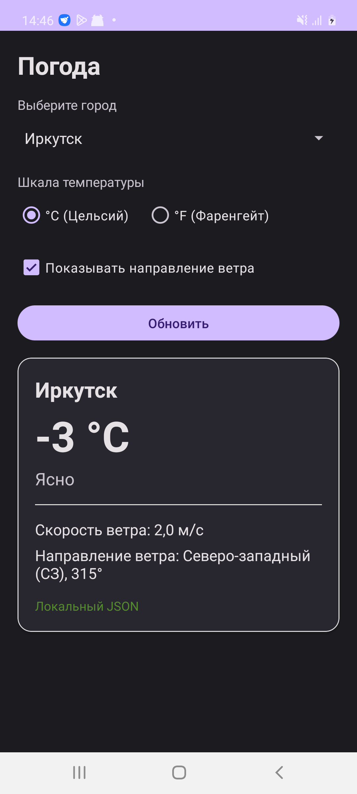
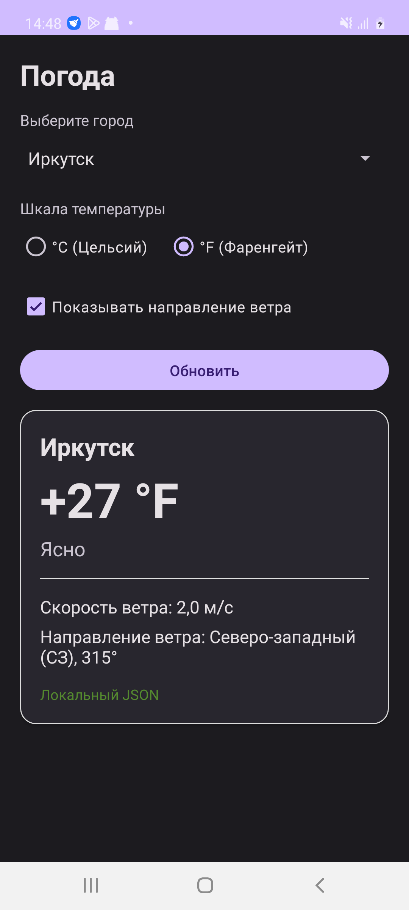
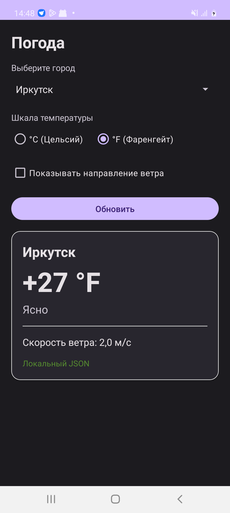
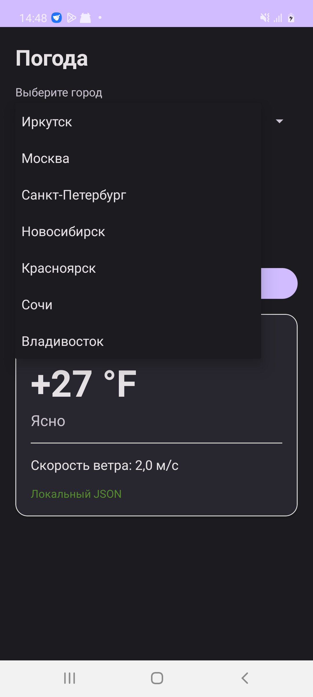
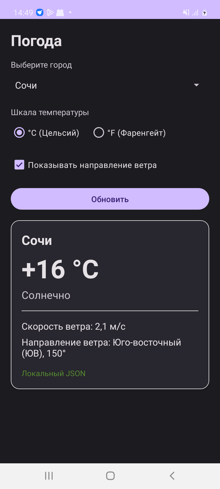

# WidgetsDemo2728 — Погодное приложение с CheckBox, Spinner и RadioButton

Android-приложение погоды с интерактивным управлением через стандартные виджеты Android: **Spinner**, **RadioGroup / RadioButton**, **CheckBox**, поддержкой **View Binding** и **Data Binding**, загрузкой данных из локального **JSON-файла** (`assets/weather.json`) и онлайн-запросами к **OpenWeatherMap API** через корутины Kotlin.

---

## Демонстрация работы приложения

| 1. Шкала °C и направление ветра | 2. Переключение на шкалу °F | 3. Скрытие направления ветра |
| :---: | :---: | :---: |
|  |  |  |

| 4. Выбор города из Spinner | 5. Погода для выбранного города (Сочи) |
| :---: | :---: |
|  |  |

---

## Реализованная функциональность

1. **Выбор города через `Spinner`**:
   * Список городов хранится в строковых ресурсах (`res/values/strings.xml`, массив `R.array.cities`).
   * При выборе нового города данные автоматически загружаются и обновляются на экране.

2. **Отображение температуры в разных шкалах (°C / °F)**:
   * Выбор шкалы осуществляется через радио-кнопки (`RadioGroup` с `RadioButton` для Цельсия и Фаренгейта).
   * Пересчет температуры происходит динамически ($T_F = T_C \times 1.8 + 32$) с мгновенным обновлением на экране.

3. **Отображение/скрытие направления ветра (`CheckBox`)**:
   * Переключатель управляет видимостью строки с направлением ветра (`View.VISIBLE` / `View.GONE`).
   * Направление ветра вычисляется из градусов ($0^\circ–360^\circ$) в румбы розы ветров (С, СВ, В, ЮВ, Ю, ЮЗ, З, СЗ).

4. **Хранение и загрузка данных о погоде**:
   * **Локальный JSON-файл** (`app/src/main/assets/weather.json`) — содержит данные для всех городов списка, обеспечивает 100% работоспособность приложения без доступа к сети.
   * **OpenWeatherMap API + Coroutines (дополнительный балл)** — приложение запрашивает актуальную погоду через корутины Kotlin на диспетчере `Dispatchers.IO`. При отсутствии подключения к интернету автоматически используется локальный JSON.

5. **Сохранение состояния**:
   * При смене конфигурации (поворот экрана) выбранный город, выбранная шкала температуры и состояние чекбокса восстанавливаются через `onSaveInstanceState` / `onRestoreInstanceState`.

6. **Тестирование**:
   * Модульные unit-тесты (`WeatherUnitTest.kt`) проверяют корректность формул перевода температуры, форматирование знаков и расчет направлений ветра по градусам.

---

## Структура проекта

* `MainActivity.kt` — логика взаимодействия с UI, обработка событий Spinner, RadioGroup, CheckBox, запуск корутин.
* `WeatherInfo.kt` — модель данных погоды, методы расчета шкалы Фаренгейта и румбов розы ветров.
* `WeatherRepository.kt` — репозиторий данных: загрузка через OpenWeatherMap API (корутины) и локальный парсинг `assets/weather.json`.
* `res/layout/activity_main.xml` — разметка интерфейса с использованием тега `<layout>`, CardView, Spinner, RadioGroup, CheckBox.
* `res/values/strings.xml` — строковые ресурсы и строковый массив городов `cities`.
* `assets/weather.json` — встроенный JSON-файл с погодными данными городов.
* `WeatherUnitTest.kt` — юнит-тесты логики преобразований.
